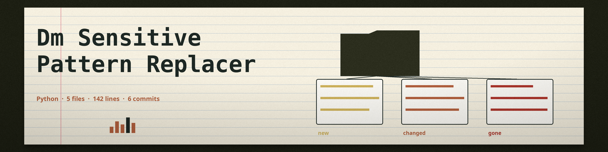

# dm-sensitive-pattern-replacer
Replaces sensitive data matching regular expressions within files with a specified replacement string. Takes a file path, regex pattern, and replacement string as input. - Focused on Tools designed to generate or mask sensitive data with realistic-looking but meaningless values

## Install
`git clone https://github.com/ShadowStrikeHQ/dm-sensitive-pattern-replacer`

## Usage
`./dm-sensitive-pattern-replacer [params]`

## Parameters
- `-h`: Show help message and exit
- `-o`: Optional: Path to the output file. If not specified, the input file is overwritten.

## License
Copyright (c) ShadowStrikeHQ

A run whose pattern matches nothing exits with an error, prints a plain no matches line, and writes no output file in separate output mode. In the default in place mode a no match run also exits with an error and leaves the input file unchanged.
